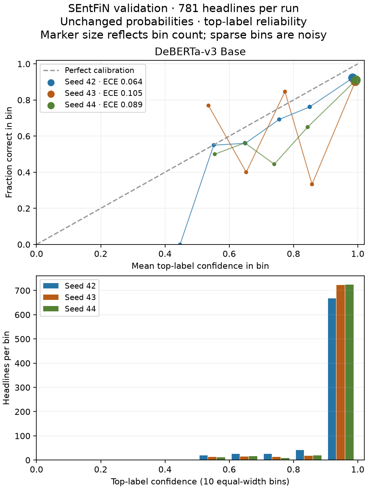

# DeBERTa-v3 Base — calibration and qualitative errors

Analyze the three saved selected-rate DeBERTa Base validation runs and compare their aggregate probability scores with the existing RoBERTa Base/FinBERT analysis. No new inference, probability adjustment, fitting, label changes or final-test scoring.

DeBERTa has the highest observed mean accuracy/macro F1 and lowest mean ECE, Brier and log loss among these three selected-rate candidates. Its mean macro F1 is 0.8810 ± 0.0044, versus RoBERTa 0.8760 ± 0.0082 and FinBERT 0.8748 ± 0.0023. These are development results, not evidence of independent superiority.

## Scope and definitions

Selected learning rate: 1e-05; seeds 42/43/44, each on the same 781 single-target SEntFiN validation headlines (247 negative, 252 neutral, 282 positive). Seed 42 selected the rate, so the three-seed mean includes selection bias. All models use the same development split and controlled settings, but select their own learning rate. [Rate study](deberta-tuning.md).

Use the same definitions as the [earlier analysis](transformer-analysis.md): top-label ECE with 10 equal-width bins (5/15-bin sensitivity); multiclass Brier = mean sum of squared errors across three classes, unnormalized range 0–2; log loss = negative natural log gold probability, clipped at 1e-15. Lower scores are better. Top-label ECE does not establish full classwise calibration; Brier/log loss reflect discrimination as well as calibration. See the [scikit-learn guide](https://scikit-learn.org/1.7/modules/calibration.html).

## Selected-rate probability comparison

All values are mean ± sample SD across three separately evaluated seeds. No probabilities are averaged into an ensemble; no best seed is selected.

| Model | Accuracy | Mean confidence | ECE | Brier | Log loss |
|---|---:|---:|---:|---:|---:|
| roberta_base | 0.8775 ± 0.0078 | 0.9807 ± 0.0070 | 0.1061 ± 0.0077 | 0.2253 ± 0.0107 | 0.6196 ± 0.0837 |
| finbert | 0.8758 ± 0.0022 | 0.9708 ± 0.0190 | 0.0950 ± 0.0194 | 0.2179 ± 0.0129 | 0.5717 ± 0.1442 |
| deberta_base | 0.8818 ± 0.0041 | 0.9642 ± 0.0149 | 0.0858 ± 0.0208 | 0.2082 ± 0.0133 | 0.4995 ± 0.0741 |
| Training-prior control | 0.3611 | 0.3580 | 0.0031 | 0.6660 | 1.0977 |

DeBERTa’s average confidence minus accuracy is **8.24 percentage points**. ECE describes the confidence/correctness mismatch on this reused validation set. The prior control has low ECE but poor accuracy, illustrating why ECE alone is insufficient. Compare the probability scores and classification scores together.

| Seed | Accuracy | Mean confidence | ECE | Brier | Log loss | Errors | Errors with confidence ≥0.9 |
|---|---:|---:|---:|---:|---:|---:|---:|
| 42 | 0.8835 | 0.9470 | 0.0636 | 0.1965 | 0.4141 | 91 | 52 |
| 43 | 0.8771 | 0.9716 | 0.1047 | 0.2226 | 0.5469 | 96 | 70 |
| 44 | 0.8848 | 0.9740 | 0.0892 | 0.2055 | 0.5374 | 90 | 65 |

ECE binning sensitivity:

| Seed | 5 bins | 10 bins | 15 bins |
|---|---:|---:|---:|
| 42 | 0.0636 | 0.0636 | 0.0651 |
| 43 | 0.1023 | 0.1047 | 0.1083 |
| 44 | 0.0892 | 0.0892 | 0.0915 |

Bin counts appear under the reliability curve because sparse bins are noisy. Empty bins are omitted from the curve and contribute zero to ECE; the probability-1 endpoint belongs to the final bin. Three seed observations and bin sensitivity are descriptive, not calibration confidence intervals.

## Class failures and persistence

| Gold class | Support | Mean F1 | Recurring errors (wrong in all 3 seeds) |
|---|---:|---:|---:|
| negative | 247 | 0.9049 | 18 |
| neutral | 252 | 0.8431 | 33 |
| positive | 282 | 0.8950 | 17 |

| Wrong in k of 3 seeds | Headlines |
|---|---:|
| 0 | 660 |
| 1 | 33 |
| 2 | 20 |
| 3 | 68 |

Predictions vary across seeds on 56 headlines. Recurring wrong predictions can differ in their wrong label; prediction variation includes switching between two wrong labels. These observations separate persistent difficulties from seed-dependent errors without adjudicating labels.

Neutral remains the weakest class (mean F1 0.8431). DeBERTa has the highest negative-class mean F1 of these candidates (0.9049); FinBERT has higher positive-class mean F1 (0.9051 versus DeBERTa 0.8950). DeBERTa’s 68 recurring errors sit between RoBERTa’s 73 and FinBERT’s 60, so it does not lead every diagnostic.

## Qualitative review

Up to two per model/persistence/gold/wrong-label cell; SHA-256(phase3:42:record_id) order; deduplicate IDs. Recurring = wrong in all three seeds; variable = wrong in one or two. Supplement: up to three errors containing no/not/never/without/n't in the same hash order. Categories fixed from Phase 2; no inferred automatic annotations.

Each unique source headline is reviewed once even if it appears in several sampling cells. The review is exploratory Codex interpretation, not independent human adjudication. Counts refer to the selected sample and must not be treated as error prevalence.

| Primary category | Reviewed examples |
|---|---:|
| event_interpretation | 3 |
| financial_context | 4 |
| mixed_cues | 11 |
| negation_scope | 3 |
| neutral_boundary | 2 |
| numeric_comparison | 3 |

The primary category findings are:

- **Mixed cues (11):** Growth against missed expectations, adverse conditions against prospective recovery, and correction against an intact longer-term trend can lead seeds to emphasize different parts of the same headline.
- **Financial context (4):** Tariff/import costs, quoted trading levels, commodity-price perspective and flat sales despite intervention require economic interpretation. A price-level forecast without a current-price anchor leaves direction unstated. These models receive headline text, not a separate target-aware input.
- **Event interpretation (3):** Regulatory instructions, rhetorical volatility comparisons and large transactions do not necessarily establish company or price impact. One native target appears to be a descriptive word rather than an entity; this is a source-quality observation, not a correction.
- **Negation scope (3):** Denying excessive strength differs from asserting weakness. Denying immediate impact differs from denying every future benefit. A negated price cut needs its sector impact interpreted alongside market movement. All three keyword supplements in this packet contain semantic negation.
- **Neutral boundary (2):** Absolute loss figures and optimistic recommendations reveal factual-versus-directional conventions. The gold label can be neutral despite language that supports an adverse/favorable interpretation.
- **Numerical comparison (3):** Small price changes, gains with negative gold and shrinking losses reveal magnitude, perspective, or change-versus-level ambiguity. Continuing losses and improving results can support different readings.

Reviewed **26** unique headlines; **18** have suspected gold ambiguity or insufficient context. This does not prove incorrect labels. All labels, records and probabilities remain intact. Original text, targets, IDs, predictions/confidences and reviewer notes are stored only in the checksum-pinned ignored packet.

## Integrity, limitations and reproduction

Report/private-run bytes, prediction hashes, ordered validation IDs, source gold labels, split lineage, selected rates, exact seed coverage, argmax/probability validity and classification metrics were checked before computing scores. The existing RoBERTa/FinBERT aggregates were independently recomputed from their saved predictions for this comparison; their historical public reports remain unchanged. Input/implementation/packet/annotation hashes are recorded in [DeBERTa JSON](deberta-analysis.json).

Reference analysis SHA-256: `f3ed7ecd3cf83038d15a686a4568bd4ba4f94db6d5a7b89d44dec432df663f15`.

Validation was already used for epoch/rate selection and repeatedly inspected. Different sample sizes and category selection make qualitative category counts unsuitable for direct model ranking. Source pretraining exposure remains uncertain. This extension supports comparison on development data only; no independent superiority or production-ready confidence claim.

See [reproduction instructions](../../docs/deberta-study.md). The same analysis module now supports the declared one-model DeBERTa extension while preserving the original two-model path. The plotting script supports one or two model panels. No new dependency or model architecture. Phase 3 remains open for final selection/test evaluation, MLflow and the broader length/batch study.

Verification: Mac/Windows Ruff lint/format and all 307 tests pass. Windows reproduces the complete probability/error analysis and review hashes (numeric tolerance 1e-12). Independent Windows checks verify all five runs and every improved epoch artifact, source/code/config lineage and unchanged frozen bytes. Independent probability-score and public-output privacy checks pass. Both figures visually reviewed.
