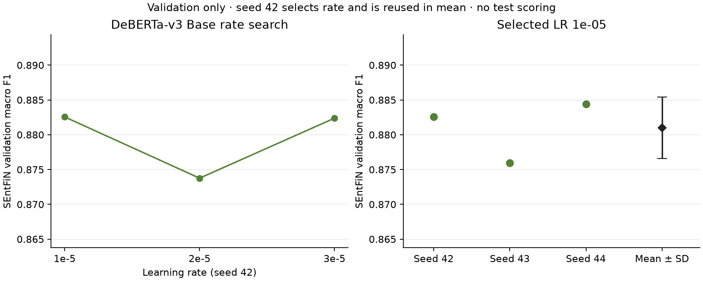

# DeBERTa-v3 Base — learning-rate and three-seed study

Five fresh source-initialized experiments extend the previous RoBERTa Base/FinBERT protocol on the unchanged 6,299-training/781-validation single-target SEntFiN cohort. No pooling, sequential adaptation, test scoring, ensemble or best-seed selection. All parameters of original Microsoft DeBERTa-v3 Base and its newly initialized sentiment head are trained.

## Controlled protocol

Rates 1e-5, 2e-5, 3e-5 are compared at seed 42. Select by best-epoch validation macro F1; exact rate ties keep ascending declaration order and exact epoch ties keep the earliest epoch. Persist the selected rate before seeds 43/44. Its seed-42 grid result is reused, so five runs yield a three-seed summary. All other settings remain fixed: deterministic FP32, TF32 off, train/evaluation batches 16/32, length 128, five epochs maximum, patience two, AdamW weight decay .01 (excluding biases/LayerNorm), warmup .1 with linear decay, and gradient clip 1.

## Rate search (seed 42)

| Learning rate | Best epoch | Accuracy | Macro F1 | Epochs run | Training + validation/save seconds | Peak allocated GiB |
|---|---:|---:|---:|---:|---:|---:|
| 1e-05 | 2 | 0.8835 | 0.8826 | 4 | 327.42 | 3.53 |
| 2e-05 | 5 | 0.8745 | 0.8738 | 5 | 391.36 | 3.53 |
| 3e-05 | 4 | 0.8835 | 0.8824 | 5 | 385.13 | 3.53 |

Selected learning rate: **1e-05**. Selection uses seed 42 only, before repeats. Macro-F1 margin over the runner-up is 0.000185; this narrow development-set difference does not establish a generally optimal learning rate.

## Selected-rate seeds

| Seed | Best epoch | Accuracy | Macro F1 |
|---|---:|---:|---:|
| 42 | 2 | 0.8835 | 0.8826 |
| 43 | 4 | 0.8771 | 0.8760 |
| 44 | 5 | 0.8848 | 0.8844 |

Macro F1 mean ± sample SD: **0.8810 ± 0.0044**. Accuracy: 0.8818 ± 0.0041.

## Comparison with existing selected-rate candidates

| Model | Selected LR | Accuracy mean ± sample SD | Macro F1 mean ± sample SD |
|---|---:|---:|---:|
| roberta_base | 2e-05 | 0.8775 ± 0.0078 | 0.8760 ± 0.0082 |
| finbert | 3e-05 | 0.8758 ± 0.0022 | 0.8748 ± 0.0023 |
| deberta_base | 1e-05 | 0.8818 ± 0.0041 | 0.8810 ± 0.0044 |

These are separately evaluated runs on one repeatedly inspected validation cohort, not independent samples, ensembles, confidence intervals or significance evidence. Seed 42 selected the learning rate and contributes to its mean; that selection bias remains. Each model has its own selected rate. The historical fixed 2e-5/seed-42 report is retained for its individual run.

## Architecture, saved artifacts and provenance

Original source: `microsoft/deberta-v3-base`, revision `8ccc9b6f36199bec6961081d44eb72fb3f7353f3`, existing reviewed MIT scope. Three-class DebertaV2 sequence-classification implementation: 12 encoder layers, 768 hidden dimensions, 12 attention heads, 184,424,451 total trainable parameters, including a new pooler/classifier. SentencePiece tokenization and FP32 loading match the historical run; no architecture or tokenizer change. All improved epochs are saved to content-addressed ignored artifact directories; selected models reload before their final validation predictions are written. Optimizer state is not persisted. Weights stay on Windows.

The [study JSON](deberta-tuning.json) records rates, seeds, code/configuration hashes, split memberships, selected artifact identities, source revisions and per-run report paths. Reports are under `deberta-tuning-runs`; no historical report is overwritten. Private run/prediction files and selected manifests are retained locally; text, IDs and weights are not published. See [running instructions](../../docs/deberta-study.md) and the separate [calibration/error analysis](deberta-analysis.md).

Selected model tensor bytes: 737,697,804; serialized weight file: 737,722,356 bytes. Complete model/tokenizer/config artifact: 740,189,720 bytes (705.90 MiB); each improved epoch has its own ignored artifact.

Broader length/batch experiments, MLflow and final configuration/test evaluation remain open.
Selected-rate inference averages 1.647 ms/text on the RTX 4070 SUPER (batched GPU inference timing; excludes upstream ingestion). No validation text was truncated. Training peak allocated GPU memory is 3.53 GiB.
The fresh 2e-5/seed-42 run exactly reproduces the historical fixed-configuration class metrics/confusion matrix. The historical report remains unchanged.

Verification: Mac/Windows Ruff lint/format and all 307 tests pass. Windows reproduces the complete probability/error analysis and review hashes (numeric tolerance 1e-12). Independent Windows checks verify all five runs and every improved epoch artifact, source/code/config lineage and unchanged frozen bytes. Independent probability-score and public-output privacy checks pass. Both figures visually reviewed.
