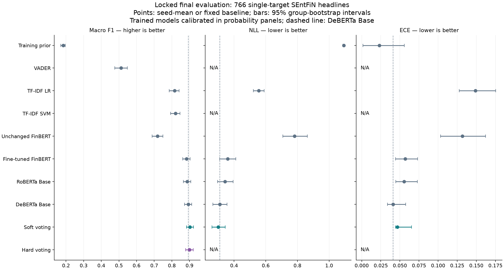

# Locked Phase 3 final sentiment evaluation

The highest observed mean macro F1 is soft voting at **90.28%**, compared with hard voting 90.03% and DeBERTa Base 89.32%. Their paired bootstrap intervals include zero, so this test does not establish an ensemble advantage over DeBERTa. Calibration lowers NLL for all three transformers; every predeclared calibration NLL difference interval is negative. No settings were changed after test inspection.

## Scope and execution

Evaluated 2026-10-13 on all **766 single-target SEntFiN headlines**, in 766 duplicate groups: 215 negative, 259 neutral and 292 positive. The source benchmark was frozen 2026-10-10. Multi-target/PhraseBank reserved tests were not scored. The original v1 primary comparison and the v2 voting supplement were locked before final inference. Five baselines plus nine selected transformer checkpoints required 14 inference passes; their saved outputs supply 29 variants and 13 aggregate families. All seeds 42/43/44 are retained, without probability averaging across seeds or best-seed selection.

Execution source revision: `a6f4836a2640745e075aebc4ffcd319c474d737b`. The report JSON is the exact exported aggregate, retaining original inference metadata, per-seed metrics, full reliability bins, all intervals and protocol lineage. Individual predictions, native labels/IDs, weights and bootstrap draws stay private.

## Classification comparison

Mean metrics across three seeds for trained transformers/voting; fixed baselines have no seed SD. Macro-F1 intervals are paired duplicate-group bootstrap percentile 95% intervals with 1,000 shared seed-42 draws. Raw and calibrated classifier F1/accuracy are identical.

| Candidate | Macro F1 (%) ± seed SD (pp) | 95% bootstrap interval (%) | Accuracy (%) |
|---|---:|---:|---:|
| Training-prior control | 18.40 (fixed) | 17.09–19.51 | 38.12 |
| VADER | 51.21 (fixed) | 47.69–54.72 | 50.78 |
| TF-IDF Logistic Regression | 81.50 (fixed) | 78.56–84.16 | 81.72 |
| TF-IDF Linear SVM | 82.04 (fixed) | 79.22–84.61 | 82.25 |
| Unchanged FinBERT | 71.82 (fixed) | 68.82–74.95 | 71.67 |
| Fine-tuned FinBERT | 88.28 ± 0.27 | 86.21–90.38 | 88.25 |
| RoBERTa Base | 88.68 ± 0.55 | 86.58–90.74 | 88.73 |
| DeBERTa Base | 89.32 ± 0.22 | 87.17–91.22 | 89.30 |
| Soft voting (supplementary) | 90.28 ± 0.51 | 88.29–92.28 | 90.25 |
| Hard voting (supplementary) | 90.03 ± 0.67 | 87.83–92.09 | 89.99 |

SEntFiN adaptation improves the observed FinBERT mean macro F1 from 71.82% unchanged to 88.28% fine-tuned. The predeclared paired transformer-minus-LR intervals are all positive. DeBERTa leads the individual-model means, but its differences against RoBERTa/FinBERT remain uncertain. SVM has the strongest observed traditional F1 (82.04%); this does not replace the validation-selected LR reference or imply a predeclared SVM significance comparison.

## Predeclared paired differences

F1 differences below are percentage points; NLL differences use the original loss scale. These are percentile intervals, not multiplicity-adjusted significance tests. An interval spanning zero is compatible with either direction.

| Comparison | Observed difference | 95% paired interval |
|---|---:|---:|
| deberta_base.calibrated minus deberta_base.raw: nll | -0.0770 | [-0.1151, -0.0411] |
| deberta_base.raw minus finbert.raw: macro_f1 | +1.0396 pp | [-0.6395, +2.5779] pp |
| deberta_base.raw minus roberta_base.raw: macro_f1 | +0.6381 pp | [-0.6636, +1.9318] pp |
| deberta_base.raw minus tfidf_logreg: macro_f1 | +7.8151 pp | [+5.1069, +10.5740] pp |
| finbert.calibrated minus finbert.raw: nll | -0.1632 | [-0.2185, -0.1113] |
| finbert.raw minus tfidf_logreg: macro_f1 | +6.7755 pp | [+4.2448, +9.3835] pp |
| hard minus deberta_base.raw: macro_f1 | +0.7078 pp | [-0.2750, +1.6932] pp |
| roberta_base.calibrated minus roberta_base.raw: nll | -0.1729 | [-0.2346, -0.1172] |
| roberta_base.raw minus tfidf_logreg: macro_f1 | +7.1769 pp | [+4.3434, +9.9699] pp |
| soft minus deberta_base.calibrated: nll | -0.0096 | [-0.0261, +0.0059] |
| soft minus deberta_base.raw: macro_f1 | +0.9589 pp | [-0.0245, +2.0123] pp |

## Calibration and probability quality

All temperatures were fitted on development validation and saved before this test. No calibrator was fitted or changed on test labels. NLL, Brier and ECE are lower-is-better; ECE is top-label with ten equal-width bins, plus 5/15-bin sensitivity in JSON. Brier is unnormalized multiclass squared error (0–2); NLL uses natural log with gold-probability floor 1e-15.

| Model | NLL raw → calibrated | Brier raw → calibrated | ECE raw → calibrated | Confidence raw → calibrated (%) | Accuracy (%) |
|---|---:|---:|---:|---:|---:|
| finbert | 0.5228 → 0.3597 | 0.2078 → 0.1854 | 0.0915 → 0.0569 | 97.13 → 88.72 | 88.25 |
| roberta_base | 0.5160 → 0.3431 | 0.2000 → 0.1751 | 0.0914 → 0.0554 | 97.82 → 88.62 | 88.73 |
| deberta_base | 0.3867 → 0.3098 | 0.1754 → 0.1596 | 0.0733 → 0.0411 | 96.58 → 88.84 | 89.30 |

Soft voting has NLL 0.3002 and Brier 0.1513, versus calibrated DeBERTa 0.3098/0.1596. Its paired NLL interval includes zero. Soft ECE is 0.0465 versus DeBERTa 0.0411: averaging calibrated members did not improve every calibration metric. Soft confidence averages 86.90% at 90.25% accuracy, indicating aggregate underconfidence. Mean confidence near accuracy alone is not sufficient calibration evidence. Hard voting, SVM and VADER have no probability metrics; vote shares, margins and sentiment proportions are not treated as calibrated probabilities. The training-prior control has low ECE (0.0232) but poor discrimination, illustrating why ECE alone is insufficient.

## Per-class F1

Mean per-class F1 across the same three seeds; support is unchanged at 215/259/292. Neutral remains the weakest class for each selected transformer and ensemble.

| Model/method | Negative | Neutral | Positive |
|---|---:|---:|---:|
| Fine-tuned FinBERT | 0.8936 | 0.8518 | 0.9030 |
| RoBERTa Base | 0.8954 | 0.8572 | 0.9078 |
| DeBERTa Base | 0.9098 | 0.8612 | 0.9086 |
| Soft voting (supplementary) | 0.9158 | 0.8765 | 0.9161 |
| Hard voting (supplementary) | 0.9142 | 0.8726 | 0.9140 |

Every per-seed confusion matrix and class support/precision/recall/F1 is available in JSON. This task does not adjudicate final-test labels or curate a new headline error sample.

## Architecture, saved size and recorded inference

No model was trained or rebuilt for this evaluation. The two TF-IDF pipelines each have 10,475 fitted word unigram/bigram features, 31,428 stored classifier coefficients/intercepts and 10,475 separate IDF values. Transformer token limits are 128 and evaluation batches 32. Timings are one GPU pass per seed or one CPU baseline pass; they are not a repeated production-serving benchmark. Loading, CPU calibration/voting, and metric computation are separate.

| Candidate | Architecture / stored parameter count | Artifact MiB | Recorded ms/text |
|---|---|---:|---:|
| TF-IDF Logistic Regression | TF-IDF → multinomial LR; 31,428 classifier parameters | 0.63 | 0.786 |
| TF-IDF Linear SVM | TF-IDF → one-vs-rest Linear SVM; 31,428 classifier parameters | 0.63 | 0.580 |
| Unchanged FinBERT | BertForSequenceClassification; 12 layers × 768 hidden; 109,484,547 parameters | 417.93 | 0.677 |
| Fine-tuned FinBERT | BertForSequenceClassification; 12 layers × 768 hidden; 109,484,547 parameters | 418.57 | 0.722 |
| RoBERTa Base | RobertaForSequenceClassification; 12 layers × 768 hidden; 124,647,939 parameters | 480.11 | 0.726 |
| DeBERTa Base | DebertaV2ForSequenceClassification; 12 layers × 768 hidden; 184,424,451 parameters | 705.90 | 1.888 |

Each ensemble uses three existing classifiers with **418,556,937 total member parameters**, zero learned voting parameters and 1604.58 MiB of combined member artifacts per seed. It requires three member inferences; soft/hard results reuse these passes, not six independent predictions. Voting adds a CPU reduction; the report records its timing separately. Model artifact bytes include tokenizers/serialization, not runtime GPU memory. TF-IDF numeric preprocessing/classifier state differs from serialized pipeline bytes. CPU batch-1 and GPU batch-32 timings are not directly comparable.

## Interpretation and limitations

The locked comparison supports a useful progression from traditional baselines to fine-tuned transformers, and development-fitted temperature scaling improves held-out NLL. Ensemble means are promising, but their advantage over the development-selected DeBERTa reference is inconclusive under the declared intervals and comes with three-model inference cost. No test winner is used to replace the model choice, select a seed, alter temperatures, or tune new configurations.

held-out SEntFiN evaluation; no known accessible-corpus overlap; pretraining exposure unknown
SEntFiN is Indian-market financial headlines, not a validated five-company US benchmark
Development scores reused for epoch/rate selection and calibration research
Hosted FinBERT weight-license scope unresolved; previously authorized private noncommercial research; no weight or headline redistribution

This is **held-out SEntFiN evaluation; no known accessible-corpus overlap; pretraining exposure unknown**. It is not a proven five-company US news benchmark. Stock prediction, ingestion and company-targeted modeling remain outside this task. Any changes inspired by these results are exploratory and need new untouched data for another confirmatory comparison.

## Lineage and reproduction

- Primary plan SHA-256: `e749b1879fd3337d947184106ea06cd32b41143fcf9279f51b57b2055f8a2601`.
- Supplementary extension SHA-256: `40c95d80dee56cd5d7c783b1806d4124fe2b79bbe3d6755c1f93214574f3744a`.
- Execution receipt SHA-256: `2d15a59f2a42705ce6f7f0769024a56a4f2ea0e615041333eaea5bad4ff5cdd6`.
- Private results SHA-256: `9bf65d64bff94ccf967f09ddfe6931f615558ca1e383a413201230091b49df91`.
- Shared bootstrap draws SHA-256: `529415373534ec82673d8335bf1f0c14ad7a0eb8c7282c92c686750af4d50353`.

See [runner instructions](../../docs/final-evaluation-runner.md). Keep the original execution revision/receipt and saved private outputs. Reproducing metrics from saved predictions does not require rerunning model inference. The exact aggregate JSON retains all values; this Markdown adds interpretation and does not modify that JSON.

