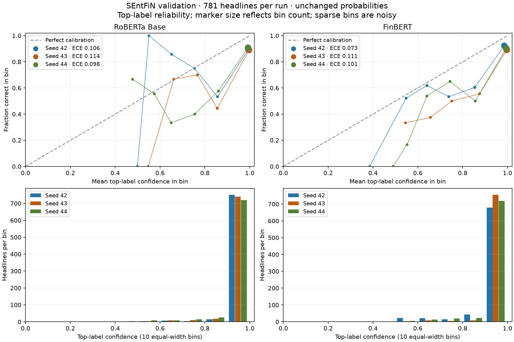

# Phase 3 — Transformer calibration and qualitative errors

RoBERTa Base and FinBERT have similar validation accuracy, but both produce probabilities that are too confident on this cohort. FinBERT has lower mean ECE, Brier and log loss across these three seeds; this descriptive result does not establish superior calibration on unseen data. Neutral remains the weakest class, and many errors recur across seeds.

## Scope and integrity

Reuse the six selected-rate runs from the [rate/seed study](transformer-tuning.md): RoBERTa Base at 2e-5 and FinBERT at 3e-5, seeds 42/43/44. Each run scores the same 781 single-target SEntFiN validation headlines (247 negative, 252 neutral, 282 positive). No retraining, new inference, probability adjustment, label edits or test scoring. PhraseBank and multi-target SEntFiN are outside this bounded analysis.

Report and private-run bytes, prediction checksums, ordered validation membership, source gold labels, split lineage, saved metrics, selected rates and exact seed coverage were verified before analysis. All six predictions stay separate; no ensemble or best seed is selected. Source texts, IDs and individual notes remain in ignored local storage. [Aggregate JSON](transformer-analysis.json) records input and implementation hashes.

## Probability diagnostics

Top-label ECE compares each bin’s average maximum probability with its fraction of correct predictions, weighted by bin size. Use 10 equal-width bins, left-inclusive/right-exclusive except the final bin includes 1; empty bins contribute zero. ECE concerns the selected label and does not fully characterize each class’s probability calibration.

Multiclass Brier is the mean sum across three labels of squared probability error against one-hot gold: range 0–2, no division by classes or scaling by one-half. Log loss (NLL) is mean negative natural log gold probability, clipped below at 1e-15. Lower scores are better. Brier and log loss reflect discrimination as well as calibration; a lower Brier score alone is insufficient to establish better calibration. See the [scikit-learn calibration guide](https://scikit-learn.org/1.7/modules/calibration.html).

Values below are mean ± sample standard deviation across three seeds; ECE is expressed as a fraction. These are descriptive seed statistics, not confidence intervals.

| Model | Accuracy | Mean confidence | ECE | Brier | Log loss |
|---|---:|---:|---:|---:|---:|
| RoBERTa Base | 0.8775 ± 0.0078 | 0.9807 ± 0.0070 | 0.1061 ± 0.0077 | 0.2253 ± 0.0107 | 0.6196 ± 0.0837 |
| FinBERT | 0.8758 ± 0.0022 | 0.9708 ± 0.0190 | 0.0950 ± 0.0194 | 0.2179 ± 0.0129 | 0.5717 ± 0.1442 |
| Training-prior control | 0.3611 | 0.3580 | 0.0031 | 0.6660 | 1.0977 |

The control always emits the three training-label proportions (1,902 negative, 2,142 neutral, 2,255 positive training headlines). Its low ECE despite poor accuracy illustrates why ECE alone cannot rank useful models. Both transformers substantially improve Brier and log loss over this control.

RoBERTa’s confidence exceeds accuracy by about 10.3 percentage points, FinBERT’s by 9.5. FinBERT seed 42 is substantially less confident than its other seeds, despite similar accuracy. None of these raw softmax scores should be presented as empirically calibrated confidence.

| Model | Seed | ECE | Brier | Log loss | Errors | Errors with confidence ≥0.9 |
|---|---:|---:|---:|---:|---:|---:|
| roberta_base | 42 | 0.1062 | 0.2215 | 0.6350 | 89 | 79 |
| roberta_base | 43 | 0.1138 | 0.2374 | 0.6945 | 101 | 81 |
| roberta_base | 44 | 0.0984 | 0.2170 | 0.5292 | 97 | 66 |
| finbert | 42 | 0.0734 | 0.2033 | 0.4294 | 96 | 52 |
| finbert | 43 | 0.1111 | 0.2276 | 0.7178 | 96 | 82 |
| finbert | 44 | 0.1005 | 0.2229 | 0.5679 | 99 | 69 |

Changing to 5 or 15 equal-width bins changes each run’s ECE by less than 0.003 absolute here. This supports the observed overconfidence pattern, but binning and small cell sizes still limit interpretation. Most probabilities lie in the highest bin. Sparse intermediate-bin points are noisy; inspect the counts with the curves.

## Class failures and seed persistence

| Model | Negative mean F1 | Neutral mean F1 | Positive mean F1 |
|---|---:|---:|---:|
| roberta_base | 0.8859 | 0.8416 | 0.9005 |
| finbert | 0.8793 | 0.8399 | 0.9051 |

| Model | Correct in all 3 seeds | Wrong in 1 seed | Wrong in 2 seeds | Wrong in all 3 seeds | Predictions vary |
|---|---:|---:|---:|---:|---:|
| roberta_base | 658 | 32 | 18 | 73 | 54 |
| finbert | 646 | 39 | 36 | 60 | 78 |

Recurring RoBERTa errors comprise 24 negative, 33 neutral and 16 positive headlines; FinBERT has 22/20/18. Wrong in all seeds does not require the same wrong label. “Predictions vary” also counts switching between two incorrect labels. Forty-six headlines are wrong in all six runs. Seed-specific RoBERTa/FinBERT disagreement counts are 69, 51 and 64; both models are wrong on 60, 75 and 68 headlines respectively. These counts are validation diagnostics, not independent repeated samples.

## Qualitative review

Review 36 unique headlines selected by fixed hash order: up to two examples per model, persistence group (wrong in all seeds versus wrong in one/two), gold label and wrong-label cell. A headline can cover multiple cells but is reviewed once. Add up to three errors containing explicit negation keywords in the same hash order, yielding 39 unique examples. The simple keyword screen also selected an ordinal abbreviation rather than semantic negation; this false positive is explicitly noted in the private review.

Assign one primary category per example, using the existing Phase 2 taxonomy. Categories are interpretive reading judgments, not inferred ground truth or model attention explanations. Counts refer to the selected sample, not error prevalence or separate per-model failure rates.

| Primary category | Reviewed examples |
|---|---:|
| event_interpretation | 6 |
| financial_context | 11 |
| mixed_cues | 9 |
| negation_scope | 4 |
| neutral_boundary | 6 |
| numeric_comparison | 3 |

- **Financial context (11):** Technical downside/short recommendations, relative underperformance, institutional fund flows, valuation and cost pressure require economic interpretation. Investor profit can differ from sentiment toward the underlying company. Commodity price changes depend on the producer/consumer perspective.
- **Mixed cues (9):** Growth against expensive valuation, recovery after declines, debt pressure against order optimism, and adverse conditions alongside proposed responses can lead models to prioritize different cues.
- **Neutral boundary (6):** Absolute earnings/loss figures without a comparison, conditional recommendations and optimistic forecasts reveal inconsistent factual-versus-directional conventions. Some favorable wording carries neutral gold and some descriptive statements carry positive gold.
- **Event interpretation (6):** Personnel changes, regulations, bulk transactions and rhetorical market commentary require context to infer impact. One native target appears to be a descriptive word rather than an entity; this is a source-quality observation, not a label correction.
- **Negation/scope and reversal (4):** Denying immediate benefit is different from denying every future benefit. Negated strength, ending a decline and removing a prohibition require resolving what is negated or reversed. This category includes semantic reversals, not just literal negation tokens.
- **Numerical comparison (3):** A reduced loss can be viewed as improving performance or a continuing loss; small price changes and gains with adverse gold expose perspective/magnitude or annotation-convention uncertainty.

Eighteen of 39 examples have suspected gold ambiguity or missing context. This does **not** establish that 18 labels are wrong. Review was performed by Codex, not independent human annotators. Gold labels remain intact; no records were dropped and nothing was tuned after review. Original headlines, targets and explanatory notes are kept in the checksum-identified private packet and annotation file.

## Decisions and remaining work

Keep both models as candidates. Classification ranking alone does not determine probability quality; seed variation affects both. Do not claim that a 0.99 output means a verified 99% chance of correctness. A separate bounded probability-calibration experiment could investigate temperature scaling, but it needs a declared calibration/assessment protocol that accounts for validation reuse. No temperature, threshold or new model was fitted here.

This analysis satisfies the calibration/error-review task for the two selected-rate candidates; it does not cover every historical model, PhraseBank or target-aware inputs. Phase 3 remains open: final configuration selection and one-time frozen-test evaluation, MLflow tracking, and the broader length/batch experiment remain pending. The validation set already selected learning rates/epochs; seed 42 also selected the rate. Binning sensitivity and three seeds do not remove that selection bias, resolve upstream exposure uncertainty or establish independent generalization.

## Reproduce

See [analysis instructions](../../docs/transformer-analysis.md). The analysis needs the original ignored development artifacts and six saved prediction files, but no GPU or model weights. The plot uses the existing `eda` dependency group. Public JSON contains all per-run bin counts, class metrics, probability scores, seed statistics, paired counts and input hashes.

Verification on Mac: Ruff lint and formatting pass; all 304 tests pass (16 new analysis tests). Independent NLL/Brier cross-checks for all six inputs, public-output privacy checks and the unchanged frozen-test byte hash pass. Figure visually reviewed.
