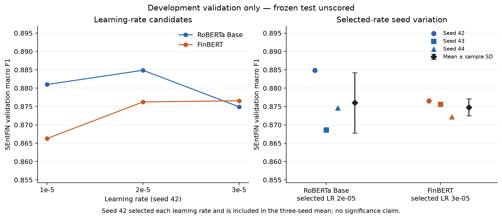

# FinSight — SEntFiN learning-rate and seed comparison

Ten fresh runs compare two original pinned sources under a predeclared protocol:
RoBERTa Base with a new sentiment head, and FinBERT with its existing financial
sentiment head. All parameters are trained. No pooling or sequential training.
The frozen test remains unscored.

The mean gap is only 0.0013 macro F1 in RoBERTa’s favor. Its observed seed
variation is larger than FinBERT’s, and the per-seed ranking reverses at seed 43.
These three development runs do not establish superiority or universal stability.

## Protocol

Use the same 6,299 training / 781 validation single-target SEntFiN records.
Validation support: negative 247, neutral 252, positive 282. Word/phrase source
records, train/validation group boundaries and labels are unchanged.

At seed 42 compare learning rates 1e-5, 2e-5 and 3e-5. Select each model’s rate
by best-epoch validation macro F1; exact rate ties retain the declared ascending
order. Within a run, strict improvement retains the earliest exact epoch tie.
Persist both choices before any additional seed result is observed. Then train
the selected rate at seeds 43 and 44, reusing its seed-42 grid run as the third
seed. Do not choose a best seed. All runs restart from original checkpoints.

Fixed: FP32, deterministic computation, TF32 off, batch 16, evaluation batch 32,
max length 128, maximum five epochs, patience two, AdamW weight decay 0.01
excluding bias/LayerNorm, warmup ratio 0.1 and gradient norm clipping 1. Source
notices, dependency lockfile, source/model/code hashes and configuration files
are recorded. RTX 4070 SUPER / CUDA 12.8; no configuration adjustments.

## Learning-rate selection at seed 42

| Model | Learning rate | Selected epoch | Accuracy | Macro F1 | Selected rate? |
| --- | ---: | ---: | ---: | ---: | --- |
| [RoBERTa Base](transformer-tuning-runs/roberta_base/lr-1e-5-seed-42/roberta_base.md) | 1e-05 | 2 | 0.8822 | 0.8810 | No |
| [RoBERTa Base](transformer-tuning-runs/roberta_base/lr-2e-5-seed-42/roberta_base.md) | 2e-05 | 4 | 0.8860 | 0.8849 | Yes |
| [RoBERTa Base](transformer-tuning-runs/roberta_base/lr-3e-5-seed-42/roberta_base.md) | 3e-05 | 2 | 0.8758 | 0.8749 | No |
| [FinBERT](transformer-tuning-runs/finbert/lr-1e-5-seed-42/finbert.md) | 1e-05 | 4 | 0.8681 | 0.8663 | No |
| [FinBERT](transformer-tuning-runs/finbert/lr-2e-5-seed-42/finbert.md) | 2e-05 | 3 | 0.8771 | 0.8762 | No |
| [FinBERT](transformer-tuning-runs/finbert/lr-3e-5-seed-42/finbert.md) | 3e-05 | 2 | 0.8771 | 0.8766 | Yes |

## Three seeds at the selected rates

| Model | Selected learning rate | Seed | Epoch | Accuracy | Macro F1 |
| --- | ---: | ---: | ---: | ---: | ---: |
| [RoBERTa Base](transformer-tuning-runs/roberta_base/lr-2e-5-seed-42/roberta_base.md) | 2e-05 | 42 | 4 | 0.8860 | 0.8849 |
| [RoBERTa Base](transformer-tuning-runs/roberta_base/lr-2e-5-seed-43/roberta_base.md) | 2e-05 | 43 | 5 | 0.8707 | 0.8686 |
| [RoBERTa Base](transformer-tuning-runs/roberta_base/lr-2e-5-seed-44/roberta_base.md) | 2e-05 | 44 | 3 | 0.8758 | 0.8746 |
| [FinBERT](transformer-tuning-runs/finbert/lr-3e-5-seed-42/finbert.md) | 3e-05 | 42 | 2 | 0.8771 | 0.8766 |
| [FinBERT](transformer-tuning-runs/finbert/lr-3e-5-seed-43/finbert.md) | 3e-05 | 43 | 5 | 0.8771 | 0.8756 |
| [FinBERT](transformer-tuning-runs/finbert/lr-3e-5-seed-44/finbert.md) | 3e-05 | 44 | 3 | 0.8732 | 0.8722 |

| Model | Accuracy mean ± sample SD | Macro F1 mean ± sample SD | Macro F1 range |
| --- | ---: | ---: | --- |
| FinBERT | 0.8758 ± 0.0022 | 0.8748 ± 0.0023 | 0.8722–0.8766 |
| RoBERTa Base | 0.8775 ± 0.0078 | 0.8760 ± 0.0082 | 0.8686–0.8849 |

Paired-seed RoBERTa minus FinBERT macro F1 differences (seeds 42/43/44): +0.0083, -0.0070, +0.0024.
Their mean difference is +0.0013; sample SD 0.0077.
These describe three observed runs; they are not confidence intervals or a
statistical significance test. A common seed number is a reproducibility
convention, not identical initialization/dropout across architectures.

## Class F1 across selected-rate seeds

| Model | Class | Support | Mean F1 | Sample SD |
| --- | --- | ---: | ---: | ---: |
| RoBERTa Base | negative | 247 | 0.8859 | 0.0098 |
| RoBERTa Base | neutral | 252 | 0.8416 | 0.0139 |
| RoBERTa Base | positive | 282 | 0.9005 | 0.0066 |
| FinBERT | negative | 247 | 0.8793 | 0.0016 |
| FinBERT | neutral | 252 | 0.8399 | 0.0042 |
| FinBERT | positive | 282 | 0.9051 | 0.0028 |

## Baselines and reproducibility check

Selected TF-IDF Logistic Regression: validation accuracy/macro F1 0.8195/0.8181.
Selected Linear SVM: 0.8169/0.8160. Unchanged FinBERT: 0.7478/0.7492. These
use the same validation membership; weights and upstream supervision differ.

| Model | Historical 2e-5 / seed-42 macro F1 | Fresh 2e-5 / seed-42 macro F1 | Exact metrics reproduced? |
| --- | ---: | ---: | --- |
| RoBERTa Base | 0.8849 | 0.8849 | Yes |
| FinBERT | 0.8762 | 0.8762 | Yes |

## Architecture, training and storage

| Model | Architecture | Parameters |
| --- | --- | ---: |
| RoBERTa Base | 12 layers, hidden 768, 12 attention heads, 3 classes | 124,647,939 |
| FinBERT | 12 layers, hidden 768, 12 attention heads, 3 classes | 109,484,547 |

| Model | Learning rate | Seed | Executed epochs | Train/validation/save seconds | Peak allocated GiB |
| --- | ---: | ---: | ---: | ---: | ---: |
| FinBERT | 1e-05 | 42 | 5 | 194.59 | 2.12 |
| FinBERT | 2e-05 | 42 | 5 | 193.88 | 2.12 |
| FinBERT | 3e-05 | 42 | 4 | 154.93 | 2.12 |
| RoBERTa Base | 1e-05 | 42 | 4 | 159.94 | 2.40 |
| RoBERTa Base | 2e-05 | 42 | 5 | 198.20 | 2.40 |
| RoBERTa Base | 3e-05 | 42 | 4 | 159.98 | 2.40 |
| FinBERT | 3e-05 | 43 | 5 | 194.28 | 2.12 |
| FinBERT | 3e-05 | 44 | 5 | 196.62 | 2.12 |
| RoBERTa Base | 2e-05 | 43 | 5 | 202.96 | 2.40 |
| RoBERTa Base | 2e-05 | 44 | 5 | 201.76 | 2.40 |

All improved epoch artifacts remain separately in ignored Windows storage. Each
selected checkpoint was reloaded and reproduced its chosen epoch metrics. No
optimizer state is stored. Mac keeps private predictions and selected manifests,
without model weights. Historical reports, sources and frozen benchmark remain
unchanged. Each per-run report includes confusion matrices, epoch history,
class metrics, truncation, latency and full lineage.

## Interpretation and limitations

Seed 42 selected the rate and is included in the three-seed mean, so that mean
has a selection-biased component. Seeds 43/44 are additional observations at
fixed rates, but they reuse the same repeatedly inspected validation set. Do not
present these scores as independent test performance or tune again based on
the best repeat. This study does not establish a universal architecture winner.

FinBERT has known upstream PhraseBank supervision; complete raw-news pretraining
exposure is unknown for both sources. Probability calibration remains unmeasured.
Upstream training history and head initialization differ despite matched project
training data and settings. Three seeds are a small
sample. Larger seed variation can motivate further controlled runs, not claims
of statistical certainty. No calibrated probabilities or final-test claim.

This task varies learning rate only. Length/batch comparisons, MLflow, contextual
error review, calibration and final configuration/test evaluation remain open.
Phase 3 is still in progress.

## Verification and provenance

Independent checks validate all ten report/run/prediction hashes, ordered IDs
and gold labels, probability normalization, recomputed metrics, split memberships,
selected rates/epochs, seed statistics, saved checkpoint files and code/configuration
lineage. Original source and frozen benchmark hashes are unchanged. Ruff and all
288 tests pass on Mac and Windows.

Plan: [configuration and rules](../../configs/transformer-tuning/plan.json).
Plan SHA-256: `6972e4696521545199f8544e60d87b765cff6ddcf26bef84a55296a4b4713d83`.
Study SHA-256: `206e36ffd82fa287e8e2d0ce49b6780600047125e1ff4dd9b8a56c9804919d21`.
Selection receipt SHA-256: `04558d8fc9529186b9bed6f4e6a4df5d4e7181ced1386c90b9568ca3c27da628`.

[Study JSON](transformer-tuning.json) preserves grid, selected runs and seed
statistics; [selection receipt](transformer-tuning-runs/selection.json) pins the
choices made before repeats. [Run guide](../../docs/transformer-tuning.md) explains
inputs, outputs, resuming and limitations. Source/private-use decisions remain
in [asset review](../../docs/datasets.md).
