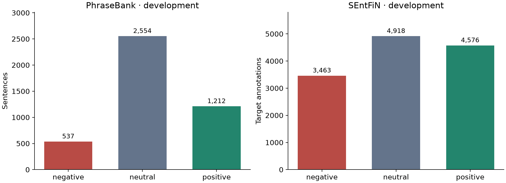
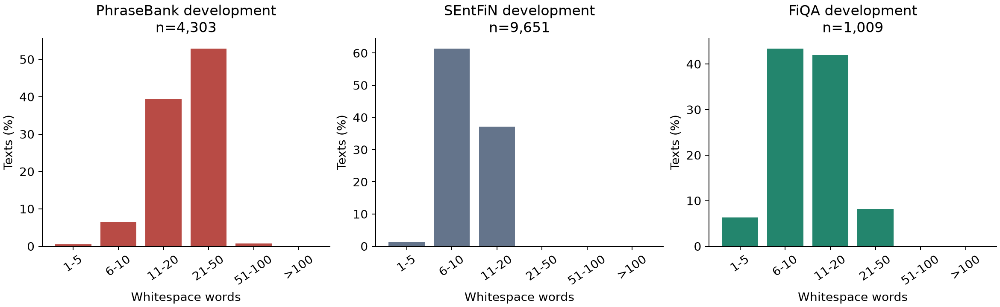
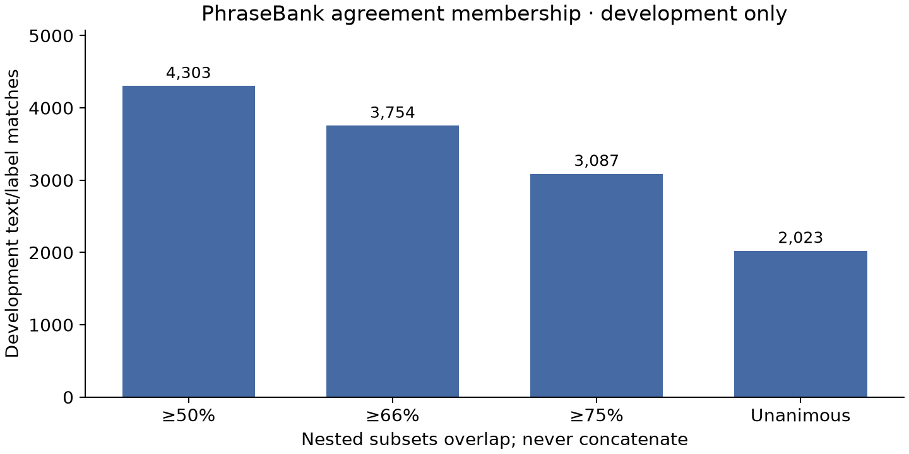
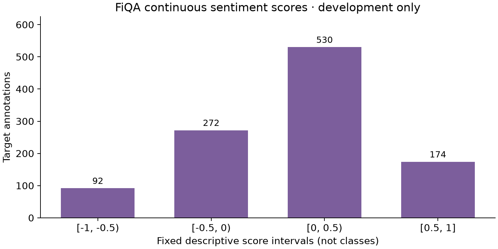
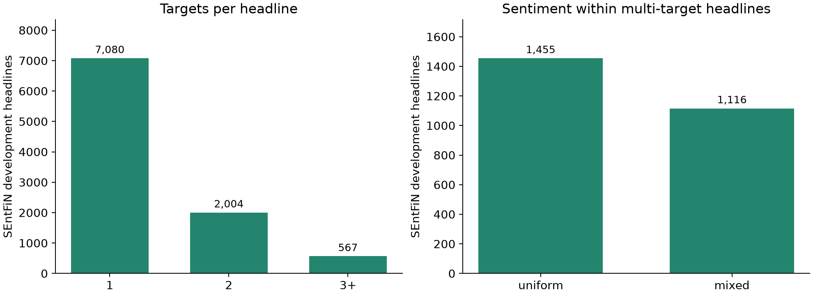

# Phase 1 development EDA

verified train + validation only; all test candidates excluded

| Corpus | Development texts | Words median | Words P95 |
| --- | ---: | ---: | ---: |
| phrasebank | 4303 | 21 | 42.0 |
| sentfin | 9651 | 10 | 14.0 |
| fiqa | 1009 | 11 | 23.0 |

Charts use retained train/validation examples only. SEntFiN class
counts are targets; length/multiplicity counts are headlines. FiQA
scores stay continuous; histogram edges are descriptive, not thresholds.
Agreement subsets overlap; membership matches are not individual votes.

See `eda-summary.json` for exact counts and source/freeze digests.
See `../docs/phase1-findings.md` for interpretation and limitations.
No frozen-test exploration, model training, or new filtering is performed.

## Supplement: class distributions across partitions

The subsequent user-requested [split-label distribution audit](split-label-distribution.md)
compares train, validation, and reserved/frozen test label aggregates for the two
Phase 2 cohorts: PhraseBank and single-target SEntFiN. It reports counts,
percentages, differences in percentage points, and imbalance ratios, with exact
values and provenance in [JSON](split-label-distribution.json). Reserved counts
use existing preparation/freeze summaries; no held-out text is inspected or
model scored. The original notebook and figures above remain development-only.
